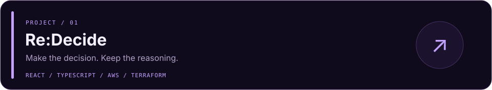
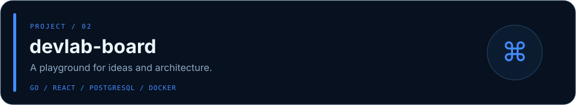
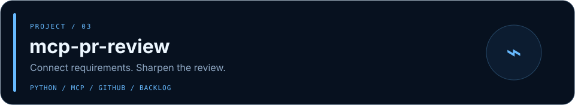
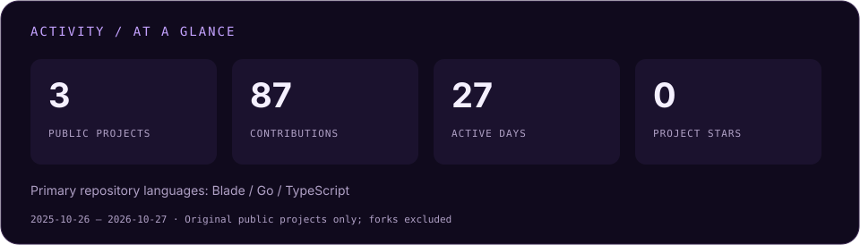
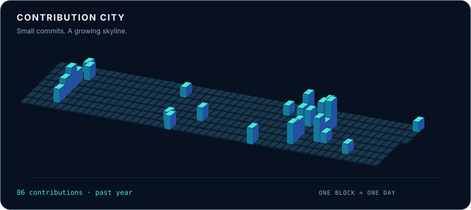
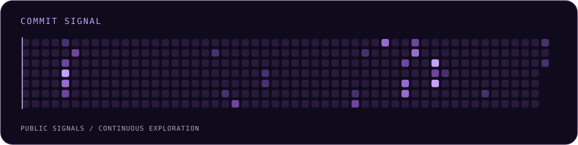

<div align="center">


**気になった技術を、動くものに。**

Webアプリ、AWSの構成検証、開発フローの自動化に取り組んでいます。

[Projects](#-selected-projects) · [Tech Stack](#-tech-stack) · [Activity](#-activity) · [Contribution City](#-contribution-city)

</div>

<br>

## ◈ About

```yaml
handle: htakumi08
focus:
  - Web applications & backend APIs
  - AWS architecture & infrastructure as code
  - MCP & developer workflow automation
approach: Build → Explore → Refine
```

<br>

## ◈ Selected Projects

<a href="https://github.com/htakumi08/Re-Decide"></a>

**[Re:Decide ↗](https://github.com/htakumi08/Re-Decide)** — 選択肢・評価基準・判断理由・振り返りを記録する、意思決定のためのプロトタイプ。

<a href="https://github.com/htakumi08/devlab-board"></a>

**[devlab-board ↗](https://github.com/htakumi08/devlab-board)** — GoとReactで機能を試しながら、AWSの複数構成を比較する開発実験ダッシュボード。

<a href="https://github.com/htakumi08/mcp-pr-review"></a>

**[mcp-pr-review ↗](https://github.com/htakumi08/mcp-pr-review)** — GitHub PRとBacklog課題をつなぎ、要求の整理からレビューまでを支えるMCPサーバーとスキル。

<div align="right">

[Explore all repositories →](https://github.com/htakumi08?tab=repositories)

</div>

<br>

## ◈ Tech Stack

公開プロジェクトで使用・検証している技術。

<div align="center">

**Languages & Web**


<br><br>

**Cloud & Infrastructure**


<br><br>

**Tools & Workflow**


</div>

<br>

## ◈ Activity



<sub>リポジトリ数・スター・主要言語は、プロフィール用リポジトリとforkを除く公開プロジェクトから集計。Contributions / Active daysは過去1年のGitHub活動です。</sub>

<br>

## ◈ Contribution City

**日々の小さな変更を、ひとつの街に。**



<sub>1棟 = 1日。高さはコントリビューション数に応じて変化します。毎日自動更新。</sub>

<details>
<summary>See the signal — 活動ヒートマップ</summary>

<br>



</details>

<br><br>


<div align="center">
<sub>Layout inspiration: <a href="https://github.com/uzuchan">uzuchan</a> · Icons: <a href="https://skillicons.dev">Skill Icons</a> · <a href="./docs/MAINTENANCE.md">Profile maintenance</a></sub>
</div>
