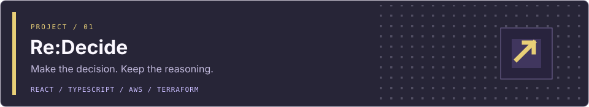
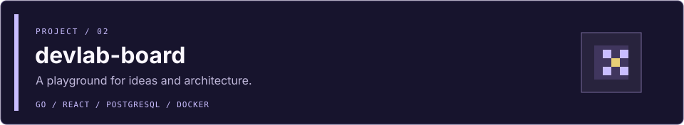
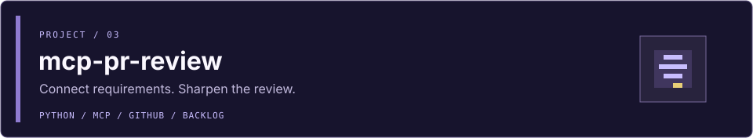
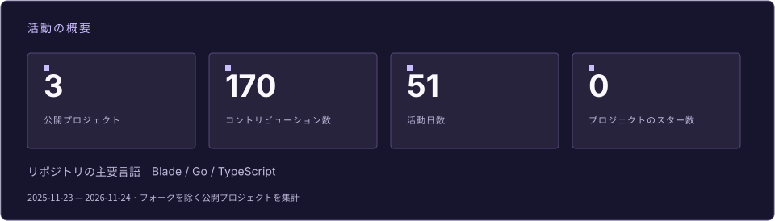
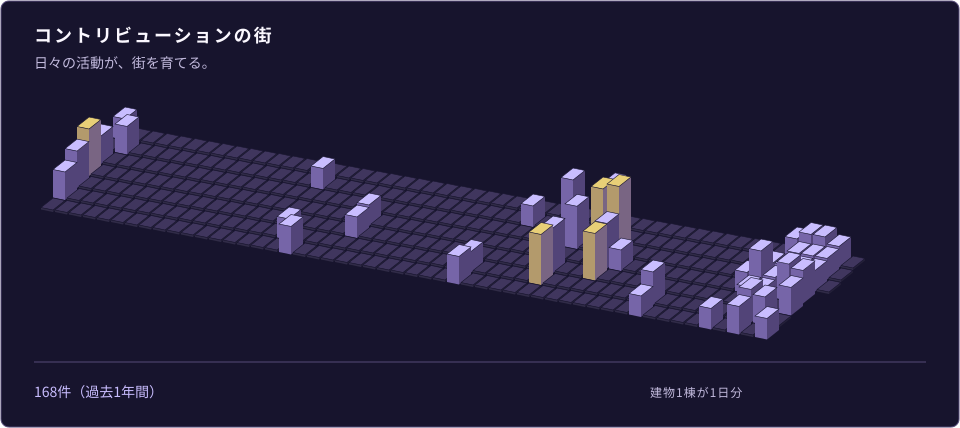
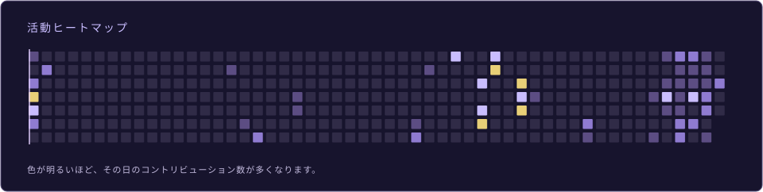

Webアプリ、AWSの構成検証、開発フローの自動化に取り組んでいます。

[プロジェクト](#user-content--プロジェクト) · [使っている技術](#user-content--使っている技術) · [活動](#user-content--活動) · [コントリビュージョン記録](#user-content--コントリビュージョン記録)

![][pixel-divider]

## ▪ 自己紹介

気になった技術は、小さくつくって試し、使いながら改善しています。

- WebアプリとバックエンドAPIの開発
- AWSの構成検証とTerraformによるインフラ管理
- MCPを使った開発フローの自動化

![][pixel-divider]

## ▪ プロジェクト

**[Re:Decide ↗](https://github.com/htakumi08/Re-Decide)** — 選択肢や評価基準、決めた理由を記録し、あとから振り返るための試作アプリ。

**[devlab-board ↗](https://github.com/htakumi08/devlab-board)** — GoとReactで新しい機能を試し、AWSの構成を比較するためのダッシュボード。

**[mcp-pr-review ↗](https://github.com/htakumi08/mcp-pr-review)** — Backlogの課題とGitHubのPRをつなぎ、要件の確認からPRレビューまでを支援するMCPサーバーとスキル。

[すべてのリポジトリを見る →](https://github.com/htakumi08?tab=repositories)

![][pixel-divider]

## ▪ 使っている技術

公開プロジェクトで使ったり、試したりしている技術です。

**言語・Web開発**

  

**クラウド・インフラ**

  

**開発ツール・自動化**

![][pixel-divider]

## ▪ 活動

リポジトリ数・スター数・主要言語の集計では、プロフィール用リポジトリとフォークを除いています。コントリビューション数と活動日数は過去1年分です。

![][pixel-divider]

## ▪ コントリビュージョン記録

**日々の小さな変更を、ひとつの街に。**

建物1棟が1日分です。その日のコントリビューション数が多いほど高くなります。毎日自動で更新します。

活動ヒートマップを見る

 

  

デザインの参考：<a href="https://github.com/uzuchan">uzuchan</a> · アイコン：<a href="https://skillicons.dev">Skill Icons</a> · <a href="./docs/MAINTENANCE.md">プロフィールの更新方法</a>

[pixel-divider]: https://raw.githubusercontent.com/htakumi08/htakumi08/2ee52a112a787bd0e8de677fe80a0d1b05c9b87a/assets/pixel-divider.svg?theme=lavender-dots
